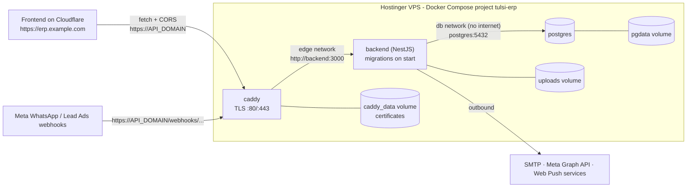

# Tulsi ERP Backend — Deployment Runbook (Hostinger VPS, Docker)

This runbook covers deploying **this repository (the NestJS backend)** from a Windows development machine to a Hostinger VPS over SSH. The **frontend (`Tulsi_Frontend`) is deployed separately on Cloudflare**. §7.5 lists what it needs from the backend.

Placeholders used throughout. Replace them with your values. **Never paste real secrets into this file.**

| Placeholder | Meaning |
|---|---|
| `VPS_IP` | Public IPv4 of the VPS (hPanel → VPS → Overview) |
| `deploy` | Non-root Linux user you create in §5 |
| `api.example.com` | `API_DOMAIN`, the public API host on the VPS |
| `https://erp.example.com` | The frontend URL on Cloudflare (goes in `CORS_ORIGINS`) |

---

## 1. Architecture overview

The backend is a **modular monolith**: one NestJS 10 process (TypeScript, Prisma 5) and one PostgreSQL database. There are no microservices, message brokers or caches. On the VPS it runs as three containers in one Docker Compose project, `tulsi-erp`:

| Service | Image | Port | Role |
|---|---|---|---|
| `caddy` | `caddy:2.10.2-alpine` | 80, 443 (public) | HTTPS for `API_DOMAIN`, with automatic Let's Encrypt certificates. Proxies to the backend. |
| `backend` | built from `./Dockerfile` (Node 24) | 3000 (internal only) | The API. Runs `prisma migrate deploy`, then `node dist/src/main`. |
| `postgres` | `postgres:16.13-alpine3.22` | 5432 (internal only) | The database |



**How the frontend connects**
- The frontend calls `https://API_DOMAIN` directly (cross-origin). `VITE_API_URL` is baked into the frontend at **build time on Cloudflare**.
- The backend only accepts browser requests from the origins in `CORS_ORIGINS`. The **last** entry is also the base of links in emails (invites, verification, password reset).
- No WebSockets or SSE. Notifications are polled in-app and also sent through Web Push.

**Inside the backend (one process, single instance only)**
- In-process jobs, via `@nestjs/schedule`: task reminders every 5 min, a push-subscription sweep every 10 s, and a WhatsApp webhook-log purge daily at 03:30. Rate limits are kept in memory. **Run exactly one backend container.**
- Auth: JWT access tokens (`JWT_ACCESS_SECRET`) plus opaque, hashed refresh tokens in the DB. Roles: SUPER_ADMIN, ADMIN, MANAGER, CALLER, DELIVERY_PARTNER, WAREHOUSE_STAFF.
- Integrations: SMTP via nodemailer, Meta WhatsApp Cloud API and Lead Ads webhooks (per-org credentials stored encrypted with `CREDENTIALS_ENCRYPTION_KEY`), and Web Push (VAPID).

**Persistent data (named Docker volumes, survive rebuilds and recreates)**

| Volume | Mounted at | Contains |
|---|---|---|
| `tulsi-erp_pgdata` | `/var/lib/postgresql/data` | The database |
| `tulsi-erp_uploads` | `/app/uploads` (backend) | `lead-imports/` (uploaded sheets), `whatsapp-media/` (WhatsApp media) |
| `tulsi-erp_caddy_data` | `/data` (caddy) | TLS certificates and ACME account |
| `tulsi-erp_caddy_config` | `/config` (caddy) | Caddy autosave config |

**Deployment files in this repo**

| File | Purpose |
|---|---|
| `Dockerfile` | Multi-stage Node 24 build, non-root runtime, health check, migrations on start |
| `.dockerignore` | Keeps `.env*`, `uploads/`, tests, docs and deploy files out of the image |
| `docker-compose.yml` | The production stack (3 services, 2 networks, 4 volumes) |
| `.env.production.example` | Every production setting, documented. Copy it to `.env` on the server. (`.env.example` remains the local-dev template.) |
| `deploy/Caddyfile` | TLS, security headers, 60 MB upload cap, proxy to `backend:3000` |
| `scripts/deploy.sh` | Validates `.env`, backs up, pulls, rebuilds, starts, waits for health, logs revisions |
| `scripts/backup.sh` | DB dump (verified) + uploads archive into `./backups`, with retention |
| `scripts/restore.sh` | Guarded restore (asks you to type `RESTORE`, takes a safety backup first) |
| `.github/workflows/deploy.yml` | CI: lint, typecheck, tests, build. On push to `main`, it SSHes in and runs `scripts/deploy.sh`. |

**Server layout:** a single clone of this repo.
```
/opt/tulsi-erp/        ← git clone of https://github.com/Samarth-1211/Tulsi_ERP
├── docker-compose.yml  Dockerfile  deploy/Caddyfile  scripts/ …
├── .env                       ← production secrets, created on the server, git-ignored
├── backups/                   ← created by backup.sh, git-ignored
└── deploy-history.log         ← written by deploy.sh, git-ignored
```

---

## 2. Hostinger VPS prerequisites

| | Required | Recommended |
|---|---|---|
| OS | 64-bit Linux that runs Docker Engine. This runbook uses **Ubuntu 24.04 LTS** commands. | Hostinger template "Ubuntu 24.04" or "Ubuntu 24.04 with Docker" |
| CPU / RAM | 1 vCPU / 2 GB RAM plus 2 GB swap. The image build (`npm ci` + `nest build`) is the peak. | **KVM 1 (1 vCPU / 4 GB)** is enough for the backend alone. KVM 2 gives headroom. |
| Disk | 15 GB free (image ≈ 550 MB, plus DB, uploads, backups) | 50 GB+. WhatsApp media accumulates in the uploads volume. |
| Access | SSH as root or a sudo user | SSH key auth, a non-root `deploy` user |
| Network | Inbound TCP 22, 80, 443 (UDP 443 optional, for HTTP/3). Outbound SMTP (587) and HTTPS. | |
| DNS | One host name for the API (`API_DOMAIN`) | |
| Accounts | SMTP mailbox (e.g. Gmail + App Password), GitHub access to this repo | Meta app, if WhatsApp / Lead Ads will be used |

Memory limits in `docker-compose.yml`: backend 1 GB, caddy 256 MB, postgres unlimited. Confirm before you start:
- [ ] The VPS is purchased and you know its IP and root password (or have uploaded an SSH key in hPanel).
- [ ] You can edit DNS for the API host name.
- [ ] Nothing else on the VPS already uses ports 80/443.
- [ ] You know the frontend's final Cloudflare URL (custom domain and/or `*.pages.dev`).

---

## 3. Local preparation (Windows, PowerShell)

### 3.1 Review the changes
```powershell
cd "D:\Freelancing Projects\Tulsi-Plywood\RCRM_Backend"
git status
git diff Dockerfile .dockerignore .gitignore .github
```
New: `docker-compose.yml`, `.env.production.example`, `deploy/Caddyfile`, `scripts/*.sh`. Rewritten: `DEPLOYMENT.md`.

### 3.2 Build and test
```powershell
npm ci
npx prisma validate
npx tsc --noEmit
npm run lint
npm test
npm run build
```

### 3.3 Validate the Docker build (optional, Docker Desktop running)
```powershell
docker build -t tulsi-erp-backend:check .
docker run --rm --entrypoint sh tulsi-erp-backend:check -c "id; ls /app; ls -A /app/uploads"
```
Expect `uid=1000(node)`, an empty `uploads`, and no `.env` in `/app`. The full stack can't be started here with your **local-dev** `.env`, because `docker compose` requires the production keys. That's intentional, so a dev `.env` can never be deployed by mistake.

### 3.4 Commit and push safely
**The server clones from GitHub, so anything that isn't committed and pushed won't deploy.** The repo currently has many uncommitted changes (code, migrations, tests). Review them, then commit them together with the deployment files:
```powershell
git ls-files | Select-String -Pattern '(^|/)\.env$|^uploads/'   # must print nothing
git add -A
git status            # read the list: no .env, no uploads/, no dist/, no backups/
git commit -m "Docker production deployment"
git push origin main
```
`.env`, `uploads/`, `dist/`, `backups/` and `deploy-history.log` are git-ignored. `.env*` and `uploads/` are also excluded from the Docker image.

> **CI note.** On push to `main`, the `deploy` job SSHes to the VPS and runs `bash scripts/deploy.sh` in `/opt/tulsi-erp`. Until the repo secrets `VPS_HOST`, `VPS_USER` and `VPS_SSH_KEY` are set and the server is prepared (§5–6), that job **fails**. That's harmless, but expect a red ✗. Remove the `deploy:` job if you prefer manual deploys.

---

## 4. SSH setup (Windows PowerShell)

Windows 10/11 include the OpenSSH client (`ssh`, `scp`, `ssh-keygen`).

```powershell
# 1. Create a key pair once (Enter for the default path; set a passphrase)
ssh-keygen -t ed25519 -C "tulsi-erp-vps"

# 2. Install the PUBLIC key for root (asks for the root password from hPanel)
type $env:USERPROFILE\.ssh\id_ed25519.pub | ssh root@VPS_IP "mkdir -p ~/.ssh && chmod 700 ~/.ssh && cat >> ~/.ssh/authorized_keys && chmod 600 ~/.ssh/authorized_keys"

# 3. Log in with the key
ssh root@VPS_IP
```
You can paste the contents of `id_ed25519.pub` in hPanel instead (VPS → Settings → SSH keys). **Only ever share the `.pub` file.** The private key never leaves your PC.

Optional `~\.ssh\config` entry (then just `ssh tulsi`):
```
Host tulsi
    HostName VPS_IP
    User deploy
    IdentityFile ~/.ssh/id_ed25519
```

| Symptom | Check |
|---|---|
| `Connection timed out` | Wrong IP, VPS stopped, or port 22 blocked in the hPanel firewall: `Test-NetConnection VPS_IP -Port 22` |
| `Connection refused` | sshd not running or on another port. Use hPanel → VPS → Browser terminal. |
| `Permission denied (publickey)` | Key not in `~/.ssh/authorized_keys`, wrong user, or bad permissions. Debug: `ssh -v deploy@VPS_IP` |
| `REMOTE HOST IDENTIFICATION HAS CHANGED` | The VPS was reinstalled: `ssh-keygen -R VPS_IP` |

---

## 5. Server preparation (Ubuntu 24.04)

Run as root (or prefix the commands with `sudo`).

### 5.1 Update packages and create the deploy user
```bash
apt update && apt upgrade -y
adduser deploy
usermod -aG sudo deploy
mkdir -p /home/deploy/.ssh && cp ~/.ssh/authorized_keys /home/deploy/.ssh/
chown -R deploy:deploy /home/deploy/.ssh && chmod 700 /home/deploy/.ssh && chmod 600 /home/deploy/.ssh/authorized_keys
```
In a **new** PowerShell window, confirm `ssh deploy@VPS_IP` works **before** hardening SSH in §11.

### 5.2 Swap (recommended on ≤ 4 GB RAM)
```bash
swapon --show                       # skip if a swap file already exists
fallocate -l 2G /swapfile && chmod 600 /swapfile && mkswap /swapfile && swapon /swapfile
echo '/swapfile none swap sw 0 0' >> /etc/fstab
```

### 5.3 Docker: verify first, install only if missing
```bash
docker --version && docker compose version
```
If both print versions, skip to 5.4. Otherwise install Docker Engine from Docker's official apt repository:
```bash
apt install -y ca-certificates curl
install -m 0755 -d /etc/apt/keyrings
curl -fsSL https://download.docker.com/linux/ubuntu/gpg -o /etc/apt/keyrings/docker.asc
chmod a+r /etc/apt/keyrings/docker.asc
echo "deb [arch=$(dpkg --print-architecture) signed-by=/etc/apt/keyrings/docker.asc] https://download.docker.com/linux/ubuntu $(. /etc/os-release && echo $VERSION_CODENAME) stable" > /etc/apt/sources.list.d/docker.list
apt update
apt install -y docker-ce docker-ce-cli containerd.io docker-buildx-plugin docker-compose-plugin
systemctl enable --now docker
docker run --rm hello-world
```
Let `deploy` run Docker without sudo (membership in the `docker` group is root-equivalent, so only trusted admins):
```bash
usermod -aG docker deploy           # takes effect at deploy's next login
```

### 5.4 Firewall
```bash
ufw allow OpenSSH
ufw allow 80/tcp
ufw allow 443/tcp
ufw allow 443/udp
ufw enable
ufw status verbose
```
If you use the **hPanel firewall** (VPS → Security → Firewall), allow the same ports there. Both layers apply.

> Docker-published ports bypass UFW. This stack publishes **only** 80/443 (the `caddy` service). `backend` and `postgres` have no published ports, so they are unreachable from the internet regardless of UFW. Never add `ports:` to them.

### 5.5 Deployment directory and repository access
```bash
mkdir -p /opt/tulsi-erp && chown deploy:deploy /opt/tulsi-erp
```
From here on, **log in as `deploy`**.

If the GitHub repo is **public**, nothing more is needed. If it's **private**, add a read-only deploy key:
```bash
ssh-keygen -t ed25519 -N "" -f ~/.ssh/tulsi_backend -C "vps-deploy-backend"
cat >> ~/.ssh/config <<'EOF'
Host github-tulsi-backend
    HostName github.com
    User git
    IdentityFile ~/.ssh/tulsi_backend
    IdentitiesOnly yes
EOF
chmod 600 ~/.ssh/config
cat ~/.ssh/tulsi_backend.pub
```
On GitHub, open the repo's **Settings → Deploy keys → Add deploy key**, paste the key, and leave "Allow write access" **off**.

---

## 6. Initial deployment

All commands run on the VPS as `deploy`.

### 6.1 Clone
```bash
cd /opt/tulsi-erp
git clone https://github.com/Samarth-1211/Tulsi_ERP.git .
# private repo (deploy key from §5.5):
# git clone git@github-tulsi-backend:Samarth-1211/Tulsi_ERP.git .
ls docker-compose.yml Dockerfile deploy/Caddyfile scripts/deploy.sh   # all four must exist (pushed in §3.4)
```

### 6.2 Create the production `.env`
```bash
cp .env.production.example .env && chmod 600 .env
openssl rand -hex 24    # → POSTGRES_PASSWORD
openssl rand -hex 48    # → JWT_ACCESS_SECRET
openssl rand -hex 32    # → CREDENTIALS_ENCRYPTION_KEY
nano .env
```
Fill in every value in the required sections (reference table in §6.7). In particular:
- `API_DOMAIN=api.example.com`
- `CORS_ORIGINS=https://erp.example.com`, the Cloudflare frontend URL(s). Put the main one last.

**Save `CREDENTIALS_ENCRYPTION_KEY`, `POSTGRES_PASSWORD`, `JWT_ACCESS_SECRET` and the VAPID keys in a password manager.**

Optional Web Push keys. Generate them once after the first build, then uncomment `VAPID_*` in `.env` and run `docker compose up -d backend`:
```bash
docker compose run --rm --no-deps backend npx web-push generate-vapid-keys
```

### 6.3 DNS first
Create the API DNS record (§7.1) now, because the certificate is requested on first start. Check from the VPS:
```bash
getent hosts api.example.com      # must print VPS_IP
```

### 6.4 Build and start
```bash
bash scripts/deploy.sh --no-pull
```
`deploy.sh` checks `.env` (missing, placeholder or blank values, `API_DOMAIN` / `CORS_ORIGINS` format, password charset, key lengths) and validates the compose file. It then builds the backend image (first build takes about 2–5 min), starts `postgres` → `backend` (migrations) → `caddy`, waits up to 5 min for all health checks, and appends the deployed revision to `deploy-history.log`. On failure it prints the backend logs.

The same steps by hand:
```bash
docker compose config --quiet
docker compose build backend
docker compose up -d --wait --wait-timeout 300
```

### 6.5 Verify
```bash
docker compose ps                                  # postgres / backend / caddy all "healthy"
docker compose logs --tail=50 backend              # "All migrations have been successfully applied", "Application listening on port 3000", "CORS enabled for: https://erp.example.com"
docker compose logs caddy | grep -i "certificate obtained"
docker compose exec backend wget -qO- http://127.0.0.1:3000/health
curl -s https://api.example.com/health            # {"status":"ok","database":"up","uptimeSeconds":...}
curl -sI https://api.example.com/api/docs | head -1   # 404 (Swagger is off in production)
# CORS check: must echo your frontend origin
curl -s -X OPTIONS https://api.example.com/auth/login -H "Origin: https://erp.example.com" -H "Access-Control-Request-Method: POST" -D - -o /dev/null | grep -i access-control-allow-origin
```

### 6.6 Create the Super Admin (once)
```bash
docker compose exec backend node dist/prisma/seed.js
```
This creates (or updates) **only** the Super Admin from `SUPERADMIN_EMAIL` / `SUPERADMIN_PASSWORD`; the seed has no demo data. Re-running it resets that password, which doubles as account recovery.

Once the frontend is live (§7.5), sign in at `https://erp.example.com/portal1234567654321`, the Super Admin portal path from `Tulsi_Frontend/src/api/client.ts`. Create the organization and its Admin there; the Admin receives an invite email, so SMTP must work.

Webhook URLs shown in the app are built from `WEBHOOK_BASE_URL=https://API_DOMAIN`:
- WhatsApp: `https://api.example.com/webhooks/whatsapp/<org-slug>`
- Meta Lead Ads: `https://api.example.com/webhooks/meta/leadgen` (verify token = `META_VERIFY_TOKEN`)
- Generic lead webhook: `https://api.example.com/webhooks/leads/<token>`

### 6.7 Environment variable reference

Set in `.env` (see `.env.production.example` for format and generation commands):

| Variable | Required | Purpose / how to get it |
|---|---|---|
| `API_DOMAIN` | Yes | API host name. Caddy gets its certificate. Becomes `WEBHOOK_BASE_URL`. |
| `ACME_EMAIL` | Yes | Let's Encrypt account / expiry notices |
| `CORS_ORIGINS` | Yes | Cloudflare frontend origin(s), comma-separated. The last one is used in email links. |
| `POSTGRES_USER` / `POSTGRES_DB` | Yes (defaults `tulsi` / `tulsi_erp`) | DB role and name, created on first start |
| `POSTGRES_PASSWORD` | Yes | `openssl rand -hex 24`. URL-safe characters only. |
| `JWT_ACCESS_SECRET` | Yes | `openssl rand -hex 48`. The app refuses fewer than 32 chars. |
| `JWT_ACCESS_EXPIRES_IN` / `JWT_REFRESH_EXPIRES_IN` | Yes (keep `15m` / `7d`) | Token lifetimes. Must not be blank. |
| `CREDENTIALS_ENCRYPTION_KEY` | Yes | `openssl rand -hex 32` (64 hex). **Back up.** |
| `SUPERADMIN_EMAIL` / `SUPERADMIN_PASSWORD` | Yes (for the seed) | Super Admin login, password 12+ chars |
| `AUTO_VERIFY_NEW_USERS` | Yes (`false`) | `true` skips email verification (testing only) |
| `SMTP_HOST` `SMTP_PORT` `SMTP_USER` `SMTP_PASS` `SMTP_FROM_NAME` `SMTP_FROM_EMAIL` | Yes | Invites, verification, password-reset OTPs. Gmail needs an App Password. |
| `VAPID_PUBLIC_KEY` / `VAPID_PRIVATE_KEY` / `VAPID_SUBJECT` | Optional | Web Push. Generate once and never change. |
| `META_APP_SECRET` | Optional (recommended with WhatsApp) | Fallback webhook-signature secret. Without it (and without a per-org secret), webhooks are accepted **unverified**. |
| `META_VERIFY_TOKEN` / `META_APP_ID` / `META_GRAPH_API_VERSION` | Optional | Lead Ads verify token, debug console, Graph version (default `v25.0`) |
| `WHATSAPP_WEBHOOK_EVENT_RETENTION_DAYS` / `WHATSAPP_DEBUG_SIMULATE_ENABLED` | Optional | Webhook log retention (default 14) / debug simulator (off in prod) |
| `SWAGGER_ENABLED` | Optional | `true` publishes `/api/docs` (default off) |
| `BACKUP_RETENTION_DAYS` | Optional | Used by `scripts/backup.sh` (default 14) |

Fixed by `docker-compose.yml` (anything in `.env` is overridden): `NODE_ENV=production`, `PORT=3000`, `DATABASE_URL=postgresql://…@postgres:5432/…`, `UPLOADS_DIR=/app/uploads`, `WEBHOOK_BASE_URL=https://API_DOMAIN`, `TRUST_PROXY=1`, `SEED_DEMO=false`.

**Leave optional settings commented out, not blank.** A blank value overrides the app's defaults and can break login or email. `deploy.sh` refuses to run with blank lines.

---

## 7. Domain, HTTPS and the Cloudflare frontend

### 7.1 API DNS record (at your DNS provider)
| Type | Name | Value | Proxy (if the zone is on Cloudflare) |
|---|---|---|---|
| A | `api` (→ api.example.com) | `VPS_IP` | **DNS only (grey cloud)** |

Use **DNS only** for the API record. Caddy issues its own certificate directly. If you proxy this record through Cloudflare (orange cloud), every request reaches the VPS from a Cloudflare IP. The backend's per-IP login rate limits would then lump unrelated users together, and certificate issuance and renewal become fragile. Proxying the API would need extra Caddy configuration (trusted Cloudflare IP ranges) and SSL mode "Full (strict)". It isn't set up here.

- Remove any **AAAA** record for the API name unless the VPS really serves IPv6.
- If the domain has **CAA** records, one must allow `letsencrypt.org`.

### 7.2 Ports (hPanel firewall + UFW)
TCP 80 (needed for issuance and HTTP→HTTPS redirect), TCP 443, optionally UDP 443.

### 7.3 Certificate (on the VPS, automatic)
Caddy requests the certificate on first start and renews it automatically (no cron). It's stored in the `tulsi-erp_caddy_data` volume.
```bash
docker compose logs caddy | grep -iE "certificate obtained|error"
curl -vI https://api.example.com/health 2>&1 | grep -E "subject:|expire date|issuer:"
```
If issuance keeps failing, fix DNS or the firewall, then run `docker compose restart caddy`. Let's Encrypt rate-limits repeated failures. While experimenting, add `acme_ca https://acme-staging-v02.api.letsencrypt.org/directory` inside the global `{ }` block of `deploy/Caddyfile`, and remove it again for a real certificate.

### 7.4 Changing the API domain later
Update `API_DOMAIN` in `.env` and DNS, then run `docker compose up -d`. Then **rebuild the frontend on Cloudflare** with the new `VITE_API_URL`, and have WhatsApp-enabled orgs update the callback URL in Meta.

### 7.5 What the Cloudflare frontend needs
The frontend (`Tulsi_Frontend`, React + Vite) is a static build. In Cloudflare **Workers & Pages → Create → Pages → Connect to Git**, select the `Tulsi_ERP-Frontend` repo and set:

| Setting | Value |
|---|---|
| Build command | `npm run build` |
| Build output directory | `dist` |
| Environment variable (Production **and** Preview) | `VITE_API_URL` = `https://api.example.com` (no trailing slash) |
| Environment variable | `NODE_VERSION` = `24` |

- `VITE_API_URL` is compiled into the JS. If it's missing, the app calls `http://localhost:3000`. Changing it requires a new Cloudflare build.
- Client-side routes (`/leads/123`, `/portal…`) work automatically on Pages, because the project has no `404.html` and Pages treats it as a single-page app. If you deploy with Workers static assets instead, set `not_found_handling = "single-page-application"`.
- After adding the custom domain (e.g. `erp.example.com`) in Pages, put the **exact** origin(s) into `CORS_ORIGINS` on the VPS and recreate the backend:
  ```bash
  nano .env                    # CORS_ORIGINS=https://tulsi-erp.pages.dev,https://erp.example.com
  docker compose up -d backend
  ```
  Preview deployments (`https://<hash>.tulsi-erp.pages.dev`) are blocked by CORS unless you list them. That's expected.

---

## 8. Database: initialization, migrations, backups

### 8.1 Initialization and migrations
- On the **first** start, the postgres image creates the role and database from `POSTGRES_USER` / `POSTGRES_PASSWORD` / `POSTGRES_DB`. Later starts reuse the `pgdata` volume, and changing these variables does **not** alter an existing database.
- On **every** backend start, `prisma migrate deploy` applies only new migrations from `prisma/migrations` and never drops or resets data. A failed migration stops the container, and the logs show the error.
- Never run `prisma migrate dev` or `prisma migrate reset` against production.
- Status: `docker compose exec backend ./node_modules/.bin/prisma migrate status`

**Changing the DB password later:**
```bash
docker compose exec postgres psql -U tulsi -d tulsi_erp -c "ALTER USER tulsi WITH PASSWORD 'NEW_HEX_PASSWORD';"
nano .env    # POSTGRES_PASSWORD=NEW_HEX_PASSWORD
docker compose up -d backend
```

### 8.2 Backups
```bash
bash scripts/backup.sh
```
This writes `backups/db-<timestamp>.dump` (pg_dump custom format, checked with `pg_restore -l`) and `backups/uploads-<timestamp>.tar.gz`, then deletes backups older than `BACKUP_RETENTION_DAYS`. `deploy.sh` runs a backup automatically before every update.

Daily at 02:30 (`crontab -e` as `deploy`):
```
30 2 * * * cd /opt/tulsi-erp && bash scripts/backup.sh >> backups/backup.log 2>&1
```
**Copy backups off the server.** **(PowerShell)**:
```powershell
scp "deploy@VPS_IP:/opt/tulsi-erp/backups/db-*.dump" "D:\Backups\TulsiERP\"
scp "deploy@VPS_IP:/opt/tulsi-erp/backups/uploads-*.tar.gz" "D:\Backups\TulsiERP\"
```
Hostinger VPS snapshots (hPanel) are a useful extra layer, not a replacement.

### 8.3 Restore (destructive, guarded)
```bash
ls -lh backups/
bash scripts/restore.sh backups/db-YYYYMMDD-HHMMSS.dump backups/uploads-YYYYMMDD-HHMMSS.tar.gz
```
The script validates the files, asks you to type `RESTORE`, and takes a safety backup. It then stops the backend, runs `pg_restore --clean --if-exists --single-transaction` (all-or-nothing), replaces uploads if given, and restarts and waits for health. Restore with the code revision that matches the backup (`deploy-history.log`).

**Test a restore before go-live:** back up, create a test record, restore, and confirm the record is gone and login still works.

### 8.4 Bringing existing local data to production (optional)
Normally production starts empty and only gets the Super Admin seed. To move your local database (`wholeseler_erp`), **(PowerShell)**:
```powershell
pg_dump -h localhost -U <local_user> -d wholeseler_erp -Fc -f tulsi-local.dump
ssh deploy@VPS_IP "mkdir -p /opt/tulsi-erp/backups"
scp tulsi-local.dump deploy@VPS_IP:/opt/tulsi-erp/backups/
```
Then on the VPS: `bash scripts/restore.sh backups/tulsi-local.dump`. If your local database still has demo accounts from an older seed (`demo.*@tulsi-erp.local`, `Demo@1234`), delete or disable them afterwards.

---

## 9. Updating the backend

### 9.1 Restart vs rebuild vs recreate
| Action | Command | Use when |
|---|---|---|
| **Restart** | `docker compose restart backend` | Same container, image and env. **Does not pick up `.env` or code changes.** |
| **Recreate** | `docker compose up -d backend` | New container from the current image with the current `.env`. Use after editing `.env`. |
| **Rebuild + recreate** | `docker compose up -d --build backend` | New image from the current code. Use after `git pull`. |

Volumes survive all three. `docker compose down` keeps volumes. **`docker compose down -v` deletes the database, uploads and certificates. Never use it in production.**

### 9.2 Standard update
```bash
cd /opt/tulsi-erp
bash scripts/deploy.sh
```
This backs up, runs `git pull --ff-only` (refusing if the server checkout has local edits), re-runs itself if the script changed, rebuilds, recreates, applies migrations, waits for health and logs the revision. With the CI secrets set, every push to `main` that passes the tests does exactly this.

Then check: sign in on the frontend, open Leads, and review `docker compose logs --tail=100 backend`.

### 9.3 Rollback
```bash
cd /opt/tulsi-erp
tail -5 deploy-history.log            # last OK line → its backend=<rev>
git checkout <rev>
bash scripts/deploy.sh --no-pull
```
If the bad release included a **migration**, the old code may not match the new schema. Restore the backup `deploy.sh` took just before that deploy (`bash scripts/restore.sh backups/db-<timestamp>.dump`). Data written since then is lost. When fixed, return to the branch: `git checkout main && bash scripts/deploy.sh`.

---

## 10. Troubleshooting

First look: `docker compose ps`, then `docker compose logs --tail=100 <service>`.

| Problem | Diagnose | Fix |
|---|---|---|
| `deploy.sh` stops with "placeholder"/"blank"/format error | Message names the key | Edit `.env`. Comment out unused optional keys. |
| `required variable … is missing a value` | `docker compose config` | Set that key in `.env` |
| Backend restarts: `Invalid environment configuration` | `docker compose logs backend` lists each problem | Fix `.env`, then `docker compose up -d backend` |
| Backend restarts during `prisma migrate deploy` | Logs show the failing migration | `docker compose exec backend ./node_modules/.bin/prisma migrate status`. Fix, then `docker compose up -d backend`. Never `migrate reset`. |
| `P1000 Authentication failed` | `.env` password ≠ password inside the existing DB | §8.1 "Changing the DB password" |
| `P1001 Can't reach database` | `docker compose ps postgres`; `docker compose logs postgres` | Wait for "healthy". Check disk (`df -h`). |
| Image build fails at `npm ci` | Build output | Lockfile out of sync (run `npm install` locally, commit `package-lock.json`). Out of memory → swap (§5.2). |
| Build/pull fails: `429 Too Many Requests` | Docker Hub anonymous limit | Wait an hour, or `docker login` with a free Docker Hub account |
| `port is already allocated` (80/443) | `sudo ss -ltnp 'sport = :80'` | Stop the other web server (`sudo systemctl disable --now nginx apache2`) |
| Frontend: "Can't connect right now" | Browser DevTools → Network: which URL is called? | `localhost:3000` → `VITE_API_URL` missing in the Cloudflare build: set it and redeploy there. Otherwise check `/health`. |
| CORS error in the browser console | `docker compose logs backend \| grep "CORS enabled"` | Add the exact frontend origin (scheme + host, no slash) to `CORS_ORIGINS`, then `docker compose up -d backend` |
| `502 Bad Gateway` | `docker compose ps backend` | Backend down or restarting → see its logs |
| Certificate errors | `docker compose logs caddy`; `dig +short A api.example.com`; `dig +short AAAA api.example.com` | DNS not pointing at VPS, record proxied (orange cloud), stale AAAA, port 80 blocked, or Let's Encrypt rate limit (wait 1 h) |
| Upload fails with 413 | Over 60 MB (Caddy) or the API's limit (lead sheet 10 MB, product file 5 MB, WhatsApp doc 50 MB / image 5 MB) | Expected limits |
| Upload fails with `EACCES` | `docker compose exec backend ls -ld /app/uploads` (should be `node`) | `docker compose run --rm --no-deps -u root --cap-add CHOWN --entrypoint chown backend -R node:node /app/uploads` |
| Everyone gets 429 "Too many requests" | Requests all look like one IP | Keep the API record DNS-only (§7.1). `TRUST_PROXY=1` is set by compose. |
| Container keeps restarting | `docker inspect tulsi-erp-backend-1 --format '{{.State.ExitCode}} {{.State.OOMKilled}}'` | OOMKilled → raise `memory:` in compose or add RAM. Otherwise read logs. |
| Disk full | `df -h`; `docker system df`; `du -sh backups` | `docker image prune -f && docker builder prune -f` (safe). Copy off and delete old backups. **Never** `docker volume prune`. |
| Emails not arriving | `docker compose logs backend \| grep -i mail` | Wrong SMTP creds / Gmail App Password / port 587 blocked: `nc -vz smtp.gmail.com 587` |
| `$'\r': command not found` | Windows line endings | `sed -i 's/\r$//' scripts/*.sh .env` |

---

## 11. Production security

**Built into this setup**
- Only Caddy is published (80/443). The API and DB live on Docker networks, and the `db` network has no internet access.
- The backend runs as the non-root `node` user with all Linux capabilities dropped. Its code is root-owned and read-only, and only `/app/uploads` is writable. All services use `no-new-privileges`. Caddy keeps only `NET_BIND_SERVICE`.
- TLS with automatic renewal and HSTS. Helmet headers on the API. CORS is limited to `CORS_ORIGINS`.
- Secrets live only in `.env` on the server (`chmod 600`, git-ignored, excluded from the image).
- The app refuses to start in production with a weak `JWT_ACCESS_SECRET`, a bad `CREDENTIALS_ENCRYPTION_KEY` or a missing `CORS_ORIGINS`. Swagger is off. Demo seeding is forced off.
- Built-in rate limits: 600 req/min per user, 10/min on login/reset, 3 per 10 min on forgot-password. Upload limits are enforced per endpoint, with a 60 MB cap at the proxy.
- Log rotation: 20 MB × 5 files per container.

**Do these yourself**
1. **SSH hardening.** After key login as `deploy` works, set `PermitRootLogin no` and `PasswordAuthentication no` in `/etc/ssh/sshd_config` (also check `/etc/ssh/sshd_config.d/*.conf`). Then `sudo systemctl restart ssh`. Optionally `sudo apt install fail2ban`.
2. **Automatic security updates:** `sudo apt install unattended-upgrades && sudo dpkg-reconfigure -plow unattended-upgrades`.
3. **Least privilege:** only trusted admins in the `sudo` and `docker` groups. The deploy key stays read-only.
4. **Backups:** daily cron, off-server copies, and one tested restore before go-live (§8).
5. **Monitoring:** point an uptime monitor at `https://api.example.com/health` (returns 503 when the DB is down).
6. **Dependency updates:** run `npm audit` monthly. Bump the pinned images (`node:24.19.0-alpine`, `postgres:16.13-alpine3.22`, `caddy:2.10.2-alpine`) deliberately. Postgres 16.x minor bumps are drop-in. A major version needs a dump/restore.
7. **WhatsApp webhooks:** set an App Secret per organization (or `META_APP_SECRET`). Otherwise inbound webhooks are accepted unverified.

**Weaknesses found during the audit (application code, not changed)**
- The Super Admin portal path is obscure, not secret (it ships in the frontend bundle). The Super Admin password is the real protection.
- The frontend stores tokens in `localStorage`, so an XSS bug would expose them. A Content-Security-Policy on the Cloudflare site (via a `_headers` file) would reduce that risk.
- Rate limits and scheduled jobs are in-memory, so they assume one backend instance.
- Locally, `.env` and `uploads/` (real lead sheets) exist. Both are git-ignored (verified not tracked) and docker-ignored.

---

## 12. Operational command reference

Run from `/opt/tulsi-erp` on the VPS.

| Task | Command |
|---|---|
| Deploy / update (backup + pull + build + verify) | `bash scripts/deploy.sh` |
| Start everything | `docker compose up -d` |
| Stop (keeps all data) | `docker compose stop` (or `docker compose down`; **never `-v`**) |
| Rebuild the image | `docker compose build backend` |
| Recreate after `.env` change | `docker compose up -d` |
| Rebuild + recreate | `docker compose up -d --build backend` |
| Restart one service | `docker compose restart backend` |
| Status / health | `docker compose ps` |
| Health endpoint | `curl -s https://api.example.com/health` |
| Logs (follow) | `docker compose logs -f --tail=100 backend` (or `caddy`, `postgres`) |
| Resource use | `docker stats --no-stream`; `df -h`; `free -h`; `docker system df` |
| Shell in backend | `docker compose exec backend sh` |
| Migration status | `docker compose exec backend ./node_modules/.bin/prisma migrate status` |
| Seed / reset Super Admin | `docker compose exec backend node dist/prisma/seed.js` |
| SQL console | `docker compose exec postgres psql -U tulsi -d tulsi_erp` |
| Back up | `bash scripts/backup.sh` |
| Restore | `bash scripts/restore.sh backups/db-….dump [backups/uploads-….tar.gz]` |
| Networks | `docker network ls \| grep tulsi-erp`; `docker network inspect tulsi-erp_db` |
| Volumes | `docker volume ls \| grep tulsi-erp`; `docker volume inspect tulsi-erp_pgdata` |
| Clean unused images/cache (safe) | `docker image prune -f && docker builder prune -f` |
| Deploy history | `cat deploy-history.log` |
